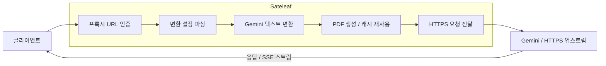

# Sateleaf 사용 가이드

Sateleaf는 Gemini 네이티브 API 요청의 긴 텍스트 컨텍스트를 PDF 첨부파일로 변환한 뒤 업스트림 서버로 전달하는 HTTPS 리버스 프록시입니다.

일반적으로 사용하는 `maximum`과 `balanced` 모드에서는 **프롬프트를 수정할 필요가 없습니다.** 평소처럼 Gemini 요청을 보내면 Sateleaf가 자동으로 텍스트를 PDF로 변환합니다.

`<pdf>...</pdf>` 태그는 특정 부분만 선택적으로 변환하는 `marked` 계열 모드에서만 필요합니다.

PageFold에서 아이디어를 얻었습니다.

## 주요 기능

- Gemini 네이티브 API의 텍스트 컨텍스트를 PDF로 변환
- `maximum`, `balanced`에서는 프롬프트 수정 불필요
- `marked` 모드에서는 원하는 구간만 선택적으로 PDF 변환
- 요청 URL을 이용한 동적 HTTPS 업스트림 선택
- 변환 대상이 아닌 요청은 일반 프록시처럼 전달
- Gemini SSE 스트리밍 응답 유지
- OpenAI 호환 Chat Completions 요청을 네이티브 Gemini로 변환해 처리(동일한 PDF 변환 적용)
- 이미지 등 비텍스트 Gemini part 보존
- 결정적인 PDF 생성
- 제한된 로컬 PDF 캐시
- 요청별 `nocache` 지원
- CORS 지원
- 데이터베이스나 영구 스토리지 불필요

## 토큰 절감 효과

2026-09-21 OOTB 스모크 측정에서 `gemini-3.5-flash-lite`, `fontsize_2`, `nocache`를 사용했습니다. 45,472자 문서 입력의 네이티브 기준은 17,056토큰이었고, Sateleaf 경유 시 `maximum`은 324토큰(**98.1%**), `balanced`는 3,490토큰(**79.5%**)이었습니다.

유즈케이스별 긴 입력에서도 같은 경향을 확인했습니다.

| 유즈케이스           | 입력 크기 | 네이티브 기준 | `maximum`       | `balanced`        |
| -------------------- | --------: | ------------: | --------------- | ----------------- |
| 코딩 어시스턴트      | 174,926자 |        42,990 | 324 (**99.2%**) | 1,715 (**96.0%**) |
| RPG / 장기 소셜 채팅 | 414,310자 |        89,057 | 590 (**99.3%**) | 1,827 (**97.9%**) |

수치는 업스트림 `countTokens`와 Sateleaf `generateContent`의 프롬프트 토큰 비교입니다. 출력 토큰, 지연시간, 품질, 실제 과금 절감 보장은 포함하지 않습니다.

## 동작 방식



지원되는 Gemini `generateContent` 요청은 선택한 모드에 따라 변환됩니다.

그 외 요청은 PDF 변환 없이 일반 HTTPS 프록시처럼 전달됩니다.

## 변환 모드

Sateleaf는 네 가지 PDF 변환 방식을 지원합니다.

대부분의 경우 `balanced` 또는 `maximum`을 사용하면 됩니다. 이 두 모드는 일반 Gemini 프롬프트를 그대로 사용할 수 있습니다.

| 모드              | 프롬프트 수정 필요 | 동작                                        |
| ----------------- | ------------------ | ------------------------------------------- |
| `maximum`         | 필요 없음          | 시스템 지시와 대화 전체를 PDF로 변환        |
| `balanced`        | 필요 없음          | 시스템 지시는 그대로 두고 대화만 PDF로 변환 |
| `marked`          | 필요               | `<pdf>...</pdf>` 안쪽만 PDF로 변환          |
| `marked_combined` | 필요               | 각 `<pdf>` 구간을 별도 PDF로 변환           |

### `maximum`

```text
mode_maximum
```

시스템 지시와 대화 전체를 PDF 컨텍스트로 변환합니다.

프롬프트는 평소처럼 보내면 됩니다.

```json
{
    "contents": [
        {
            "role": "user",
            "parts": [
                {
                    "text": "아주 긴 프롬프트..."
                }
            ]
        }
    ]
}
```

`<pdf>` 태그를 추가할 필요가 없습니다.

네이티브 Gemini 텍스트의 양을 가능한 한 줄이고 싶을 때 적합합니다.

### `balanced`

```text
mode_balanced
```

대화 내용은 PDF로 변환하고 시스템 지시는 기존 Gemini 네이티브 텍스트로 유지합니다.

이 모드 역시 프롬프트를 수정할 필요가 없습니다.

일반적인 사용에서 가장 무난한 절충 모드입니다.

### `marked`

```text
mode_marked
```

`<pdf>...</pdf>` 안에 있는 텍스트만 PDF로 변환합니다.

```xml
이 부분은 네이티브 텍스트입니다.

<pdf>
이 부분만 PDF로 변환됩니다.
</pdf>

이 부분은 다시 네이티브 텍스트입니다.
```

특정 부분만 PDF로 보내고 싶을 때 사용합니다.

`<pdf>` 태그가 하나도 없다면 선택적으로 변환할 텍스트도 없습니다.

### `marked_combined`

```text
mode_marked_combined
```

`marked`와 비슷하지만 각 `<pdf>` 구간을 별도의 PDF 첨부파일로 생성합니다.

```text
root / PART 1
root / PART 2
root / PART 3
...
```

이 모드에서는 marker의 `name=` 속성을 무시합니다.

## 설치

필요한 환경:

- Node.js 26 이상
- pnpm 10

저장소를 내려받습니다.

```sh
git clone https://github.com/concertypin/sateleaf.git
cd sateleaf

corepack enable
pnpm install --frozen-lockfile
```

프록시 접근에 사용할 secret을 설정합니다.

```sh
export PROXY_SECRET="a-long-readable-secret"
```

필요하다면 최대 요청 크기도 지정할 수 있습니다.

```sh
export MAX_REQUEST_BYTES=26214400
```

개발 서버 실행:

```sh
pnpm dev
```

프로덕션 빌드 및 실행:

```sh
pnpm build
pnpm start
```

프로덕션 서버는 `PORT` 환경변수를 사용하며, 지정하지 않으면 `3000` 포트에서 실행됩니다.

## 기본 엔드포인트

상태 확인:

```text
GET /
GET /health
```

런타임 사용 설명서:

```text
GET /docs
```

`/docs`는 Markdown 문서를 반환합니다.

## 프록시 URL

기본 형식:

```text
https://your-sateleaf.example/proxy/{proxy-secret}/{settings}/{upstream-host-and-path}
```

예시:

```text
https://your-sateleaf.example/proxy/my-secret/mode_balanced,fontsize_1/generativelanguage.googleapis.com/v1beta/models/gemini-3.8-flash:generateContent
```

업스트림 부분에는 `https://`를 넣지 않습니다.

Sateleaf가 자동으로 HTTPS 스킴을 붙입니다.

쿼리 문자열은 일반 URL처럼 뒤에 붙입니다.

```text
.../generativelanguage.googleapis.com/v1beta/models/gemini-3.8-flash:streamGenerateContent?alt=sse
```

설정 영역에는 `.`을 넣으면 안 됩니다.

점은 업스트림 호스트 및 경로 부분을 구분하는 데 사용됩니다.

## 설정 문법

설정은 쉼표로 구분합니다.

```text
mode_balanced,fontsize_1
```

다음과 같은 형식도 사용할 수 있습니다.

```text
mode=balanced,fontSize=1
```

고정된 base URL만 설정할 수 있는 클라이언트에서는 언더스코어 형식이 편리합니다.

## PDF 글자 크기

```text
fontsize_1
```

`0`보다 크고 `12` 이하인 값을 사용할 수 있습니다.

예:

```text
mode_balanced,fontsize_2
```

## 캐시 비활성화

설정에 `nocache`를 추가합니다.

```text
mode_balanced,fontsize_1,nocache
```

해당 요청에서는 PDF 캐시 파일을 읽거나 쓰지 않습니다.

변환된 프롬프트가 로컬 임시 디렉터리에 남는 것을 피하고 싶을 때 사용할 수 있습니다.

## Gemini 4 이상 허용

```text
mode_balanced,fontsize_1,allowgemini4
```

기본적으로 Gemini 4 이상 모델(`gemini-<major>` 형태의 모델 이름에서 major가 4 이상, 예: `gemini-4-flash`)에 대한 요청은 HTTP 400으로 거부됩니다. 이 모델들에서는 PDF 변환으로 토큰이 더 이상 절감되지 않기 때문입니다. 이 검사는 네이티브 `generateContent` / `streamGenerateContent` 요청과 OpenAI 호환 chat completions 모두에 적용됩니다. 그래도 프록시하려면 설정에 `allowgemini4`를 추가합니다.

## Gemini 요청 예시

`balanced` 또는 `maximum`에서는 별도의 Sateleaf 전용 태그를 넣지 않아도 됩니다.

일반 Gemini 요청을 그대로 보냅니다.

```sh
curl \
  -X POST \
  -H "Content-Type: application/json" \
  -H "x-goog-api-key: YOUR_GEMINI_API_KEY" \
  "https://your-sateleaf.example/proxy/YOUR_PROXY_SECRET/mode_balanced,fontsize_1/generativelanguage.googleapis.com/v1beta/models/gemini-3.8-flash:generateContent" \
  -d '{
    "contents": [
      {
        "role": "user",
        "parts": [
          {
            "text": "Hello from Sateleaf"
          }
        ]
      }
    ]
  }'
```

Sateleaf가 대화 텍스트를 자동으로 PDF로 변환한 뒤 업스트림으로 전달합니다.

다음과 같은 인증 헤더도 그대로 업스트림에 전달됩니다.

```text
Authorization: Bearer ...
X-Goog-API-Key: ...
```

Sateleaf는 공급자별 인증 방식을 별도로 해석하지 않습니다.

프록시 과정에서 다시 생성해야 하는 일부 헤더만 제거합니다.

```text
Host
Content-Length
Connection
Transfer-Encoding
```

## 변환 대상 엔드포인트

현재 PDF 변환 대상:

```text
POST .../models/:model:generateContent
```

스트리밍:

```text
POST .../models/:model:streamGenerateContent?alt=sse
```

업스트림 경로가 `/openai/chat/completions`로 끝나는 Chat Completions 요청은 위 네이티브 호출로 변환됩니다. [OpenAI 호환 chat completions](#openai-호환-chat-completions)를 참고하세요.

그 외 메서드와 경로는 PDF 변환 없이 그대로 전달됩니다.

SSE 응답 역시 전체 내용을 메모리에 버퍼링하지 않고 스트림 형태로 전달합니다.

기본적으로 SSE 응답 헤더를 받으면 즉시 `: keepalive` 주석을 보내고,
이후 이벤트 사이에 15초마다 주석을 전송합니다. 업스트림 HTTP 상태와 헤더는 유지됩니다.
PDF 변환이나 업스트림 응답 헤더 대기가 30초를 넘는 경우에는 기본 모드만으로
Heroku의 최초 응답 제한을 피할 수 없습니다.

주석 전송을 끄려면 설정에 `nokeepalive`를 추가합니다.

```text
mode_balanced,fontsize_1,nokeepalive
```

PDF 변환·업스트림 헤더 대기부터 보호하려면 `earlykeepalive`를 추가합니다.

```text
.../proxy/YOUR_PROXY_SECRET/mode_balanced,fontsize_1,earlykeepalive/generativelanguage.googleapis.com/v1beta/models/MODEL:streamGenerateContent?alt=sse
```

이 모드는 URL 인증과 설정 검증 직후 HTTP 200 및 SSE keepalive를 보내고 처리를 시작합니다.
`alt=sse` 또는 `Accept: text/event-stream`으로 SSE 요청임을 명시해야 하며 HEAD는 지원하지 않습니다.
`nokeepalive`와 `earlykeepalive`는 함께 사용할 수 없습니다.
선제 응답 후에는 업스트림 HTTP 상태·헤더를 클라이언트 응답에 반영할 수 없습니다.
잘못된 본문, 크기 제한, 업스트림 HTTP 오류 또는 SSE가 아닌 응답은 SSE `error` 이벤트로 전달됩니다.
HTTP 오류 이벤트는 원래 응답을 `upstreamBody`에 보존합니다(JSON이면 파싱한 값, 아니면 원문 텍스트).
`contentType`과 `error.status`도 함께 전달하며, 오류 본문은 1 MiB까지 읽고 초과 시 `bodyTruncated`로 표시합니다.
본문 읽기 실패 시 받은 부분을 보존하고 `bodyReadFailed`와 `bodyTruncated`로 표시합니다.
공급자의 상세 오류 메시지와 재시도 정보는 `upstreamBody`에서 확인할 수 있습니다.
keepalive는 모델 응답을 앞당기지 않으며, dyno 기동 전 대기나 이벤트 루프가 막힌 동안에는 전송할 수 없습니다.

클라이언트 연결 종료 시 업스트림 요청과 응답 읽기를 취소합니다.
진행 중인 PDF 변환은 완료될 수 있지만, 이후 업스트림으로 전송하지 않습니다.
`proxy_timing` 로그의 `preparationMs`는 본문 읽기·PDF 변환 시간이고,
`upstreamHeadersMs`는 업스트림 응답 헤더 대기 시간입니다.
`proxy_first_upstream_byte`의 `upstreamBodyWaitMs`는 헤더 이후 첫 응답 데이터 대기 시간이고,
`requestToFirstByteMs`는 요청 처리 시작부터 실제 업스트림 첫 청크까지입니다.
프록시가 생성한 keepalive와 오류 이벤트는 첫 업스트림 청크 측정에 포함하지 않습니다.
로그에는 프롬프트, 인증 정보, 요청 URL을 포함하지 않습니다.

응답의 `Server-Timing` 헤더에는 `prepare`(본문 읽기·변환),
`transform`(PDF 변환·캐시 처리, 변환 요청에만 포함), `upstream_headers`가
밀리초 단위로 표시됩니다. `transform`은 `prepare`에 포함되므로 합산하지 않습니다.
Node HTTP 서버에서는 스트림 정상 종료 시 `Server-Timing` trailer로
`upstream_body_wait`(헤더 이후 첫 업스트림 청크 대기),
`first_upstream_byte`(요청 처리 시작부터 실제 첫 업스트림 청크), `stream`(응답 본문 처리 전체)도 보냅니다.
`earlykeepalive`에서는 준비·변환·헤더 대기 시간도 일반 헤더 대신 종료 trailer로 전달합니다.
브라우저 개발자 도구에서 확인할 수 있지만 Fetch API는 trailer를 제공하지 않습니다.
Heroku 등 중간 프록시가 trailer를 보존하는지는 배포 환경에서 확인해야 합니다.

## OpenAI 호환 chat completions

Sateleaf는 OpenAI Chat Completions 요청도 받아 네이티브 Gemini로 처리합니다. 업스트림 경로가 `/openai/chat/completions`로 끝나면 이 모드로 동작합니다.

```text
# Vertex AI express 모드
.../proxy/{secret}/{settings}/aiplatform.googleapis.com/v1/publishers/google/openai/chat/completions

# Gemini Developer API
.../proxy/{secret}/{settings}/generativelanguage.googleapis.com/v1beta/openai/chat/completions

# Vertex AI 프로젝트 경로
.../proxy/{secret}/{settings}/{region}-aiplatform.googleapis.com/v1/projects/{project}/locations/{location}/publishers/google/openai/chat/completions
```

> **Gemini Developer API 동작 변경.** `generativelanguage.googleapis.com/v1beta/openai/chat/completions`로 가는 요청은 이전에는 Google의 자체 OpenAI 호환 엔드포인트로 바이트 단위 그대로 전달되었습니다. 이제는 네이티브 Gemini 호출로 변환되고 다른 요청처럼 PDF로 변환됩니다. 이 경로에서는 더 이상 Google의 OpenAI 호환 엔드포인트에 도달하지 않습니다.

### 동작 방식

변환은 [`ai-compatibles`](https://github.com/concertypin/ai-compatibles) 라이브러리가 수행합니다.

1. OpenAI 요청을 해석하고 `model` 필드에서 모델을 읽습니다.
2. 네이티브 Gemini 요청으로 다시 만들고 평소처럼 PDF 변환을 적용한 뒤 `models/{model}:generateContent`로 보냅니다. `stream`이 `true`이면 `models/{model}:streamGenerateContent?alt=sse`로 보냅니다. 업스트림 URL은 `/openai/chat/completions` 앞의 경로에서 만들고, 쿼리 파라미터는 유지합니다.
3. Gemini 응답(또는 SSE 스트림)을 Chat Completions 형식으로 되돌려 보냅니다.

Gemini 4의 long decode에서 한 요청이 출력 한도(비스트리밍 32K, 스트리밍 64K)에 닿아 `CONTINUATION`으로 끝나면, 프록시가 같은 요청에 `continuationToken`을 붙여 이어서 요청합니다. 클라이언트는 하나의 응답만 받고, usage는 모든 홉을 더한 값입니다(Google이 프록시에 권장하는 방식). 스트림이 홉 중간에 끊기면 체크포인트에서 재개하지 않고 오류로 끝납니다. 네이티브 Gemini 요청에는 이어 받기를 하지 않습니다.

`POST`만 허용하며(다른 메서드는 405), 요청 본문은 `MAX_REQUEST_BYTES` 이내여야 합니다.

### 인증

`Authorization: Bearer <key>`는 `x-goog-api-key: <key>`로 바뀝니다. 클라이언트가 이미 `x-goog-api-key`를 보낸 경우에는 그대로 둡니다. 경로에 `/projects/`가 있는 Vertex 경로에서는 bearer 토큰이 OAuth 액세스 토큰이므로 `Authorization`으로 그대로 전달합니다.

### 지원 기능

- 스트리밍 및 비스트리밍 응답
- `tools`, `tool_choice`, 병렬 tool call
- Gemini thought signature는 `tool_calls[].extra_content.google.thought_signature`로 왕복합니다. 클라이언트는 tool call을 되돌려 보낼 때 이 값도 함께 보내야 합니다. 클라이언트가 이 값을 버리면 Sateleaf가 Google의 `skip_thought_signature_validator` 자리표시자를 대신 보냅니다.
- `reasoning_effort`는 그대로 Gemini `thinkingLevel`로 전달됩니다. 생각 요약은 `reasoning_content`로 반환됩니다.
- `extra_body.google.thinking_config`
- `response_format`의 `json_object`, `json_schema`
- base64 `data:` URL 이미지
- reasoning 및 캐시 토큰을 포함한 `usage`
- Gemini의 상태·코드를 담은 OpenAI 오류 형식

### 제한

- 원격 이미지 URL은 거부됩니다. 이미지는 base64 data URL로 보내세요.
- ai-compatibles가 표현할 수 없는 요청은 조용히 무시되지 않고 OpenAI 오류 형식으로 거부됩니다.
- Gemini 4 이상 모델은 `allowgemini4`가 없으면 거부됩니다.
- `nocache`, `fontsize`, 변환 모드는 네이티브 요청과 동일하게 동작합니다.

### 예시

```sh
curl \
  -X POST \
  -H "Content-Type: application/json" \
  -H "Authorization: Bearer YOUR_GEMINI_API_KEY" \
  "https://your-sateleaf.example/proxy/YOUR_PROXY_SECRET/mode_balanced,fontsize_1/generativelanguage.googleapis.com/v1beta/openai/chat/completions" \
  -d '{
    "model": "gemini-3.8-flash",
    "messages": [{ "role": "user", "content": "Hello from Sateleaf" }],
    "stream": false
  }'
```

OpenAI SDK에서는 Sateleaf 접두 경로를 `base_url`에, 공급자 키를 `api_key`에 넣습니다.

```python
from openai import OpenAI

client = OpenAI(
    base_url="https://your-sateleaf.example/proxy/YOUR_PROXY_SECRET/mode_balanced,fontsize_1/generativelanguage.googleapis.com/v1beta/openai",
    api_key="YOUR_GEMINI_API_KEY",
)
reply = client.chat.completions.create(
    model="gemini-3.8-flash",
    messages=[{"role": "user", "content": "Hello from Sateleaf"}],
)
```

SDK가 `/chat/completions`를 덧붙입니다. Vertex AI express 모드에서는 `.../aiplatform.googleapis.com/v1/publishers/google/openai`를 사용하세요.

### OpenAI 모드의 keepalive

기본 keepalive는 네이티브 SSE와 같이 스트리밍 응답에 적용됩니다. `earlykeepalive`를 쓰면 준비와 업스트림 호출 시작 전에 HTTP 200이 먼저 확정되므로 오류가 HTTP 상태를 쓸 수 없습니다. 대신 원래 상태가 오류 객체의 `status`로 추가됩니다.

- `stream: true`: 15초마다 `: keepalive` 주석을 보내는 SSE 응답입니다. 200 이후에 발생한 오류는 `data: {"error":{...,"status":<http status>}}`에 이어 `data: [DONE]`으로 전달되며, OpenAI SDK는 이를 API 오류로 처리합니다.
- `stream: false`(또는 생략): `200 application/json` 응답을 즉시 확정하고, 15초마다 개행 문자(JSON에서 의미 없는 공백)를 보낸 뒤 JSON 본문을 보냅니다. 오류는 본문에 `{"error":{...,"status":<http status>}}` 형태로 들어갑니다.

네이티브 요청과 달리 OpenAI 모드의 `earlykeepalive`는 `alt=sse`나 `Accept: text/event-stream` 헤더를 요구하지 않으며 `stream` 필드로 결정합니다. 잘못된 본문 등은 응답이 확정되기 전에 일반 HTTP 오류 상태로 거부됩니다.

## 이미지와 멀티모달 컨텍스트

Sateleaf의 PDF 변환 대상은 텍스트입니다.

이미지 등 기존 비텍스트 Gemini part는 유지됩니다.

예를 들어 한 user turn 안에:

```text
텍스트
이미지
텍스트
```

가 들어 있다면 변환 후에도 이미지와 생성된 PDF는 같은 원본 user turn에 유지됩니다.

Sateleaf는 하나의 원본 Gemini content를 여러 개의 가상 turn으로 분리하지 않습니다.

tool 대화(`functionCall` 또는 `functionResponse` part가 있는 요청)에서는 텍스트가 전부 PDF로 옮겨져 비게 된 user turn을 짧은 대체 텍스트 turn(`[This turn's text is in the attached PDF transcript.]`)으로 남겨 둡니다. Gemini는 function call turn이 user 또는 function response turn 뒤에 오도록 요구하므로, 비어 버린 turn을 없애면 요청이 유효하지 않게 되기 때문입니다. 마지막 user turn이 function response turn이면 PDF는 그 뒤에 별도 user turn으로 붙입니다. Vertex AI가 function response 뒤에 다른 part가 붙은 turn을 거절하기 때문입니다("Requests ending with a model turn are not supported").

## PDF 캐시

생성된 PDF는 운영체제의 임시 디렉터리에 캐시될 수 있습니다.

| 항목                 | 값     |
| -------------------- | ------ |
| 최대 엔트리 수       | 64     |
| 전체 크기            | 32 MiB |
| PDF 하나의 최대 크기 | 8 MiB  |
| TTL                  | 10분   |

캐시 파일 이름은 SHA-256 해시이므로 프롬프트 텍스트 자체가 파일명에 들어가지는 않습니다.

다만 PDF 파일 내부에는 실제 변환된 프롬프트 내용이 포함됩니다.

캐시를 사용하지 않으려면:

```text
nocache
```

를 추가합니다.

Sateleaf는 동일한 입력에서 가능한 한 안정적인 PDF와 요청 prefix를 생성하도록 설계되어 있습니다.

이를 통해 Gemini의 implicit prompt caching이 재사용될 가능성을 유지하려 하지만, 실제 캐시 적중 여부는 업스트림 동작에 따라 달라집니다.

## CORS

브라우저의 `OPTIONS` preflight 요청은 Sateleaf가 직접 처리합니다.

요청에 `Origin`이 포함된 경우:

- 해당 Origin을 `Access-Control-Allow-Origin`으로 반영
- 요청된 헤더 허용
- credentials 허용
- 응답 헤더 노출
- `Vary: Origin` 추가

`Origin`이 없는 요청에는 CORS 헤더를 추가하지 않습니다.

## 환경변수

### `PROXY_SECRET`

필수입니다.

```text
PROXY_SECRET=a-long-readable-secret
```

여러 secret은 쉼표로 구분해 등록할 수 있으며, 항목 앞뒤 공백은 무시합니다.

```text
PROXY_SECRET=primary-secret, backup-secret
```

프록시 URL의 secret이 이 값들 중 하나와 일치해야 합니다.

### `MAX_REQUEST_BYTES`

최대 요청 본문 크기입니다.

```text
MAX_REQUEST_BYTES=26214400
```

유효한 양의 바이트 값을 사용해야 합니다.

### `PORT`

프로덕션 서버 포트입니다.

```text
PORT=3000
```

지정하지 않으면 `3000`을 사용합니다.

## Heroku 배포

```sh
corepack enable
pnpm install --frozen-lockfile
pnpm check

heroku create your-sateleaf
heroku config:set PROXY_SECRET="a-long-readable-secret"

git push heroku main
```

클라이언트가 base URL과 Bearer token만 설정할 수 있다면 Sateleaf의 `/proxy/.../` 부분까지를 base URL로 지정하고 실제 공급자 API 키를 Bearer token으로 넣을 수 있습니다.

이 경우:

- Sateleaf의 `PROXY_SECRET`은 URL에 포함됩니다.
- Bearer token은 수정하지 않고 업스트림으로 전달됩니다.

## 개발 명령어

```sh
pnpm dev
pnpm build
pnpm test

pnpm format
pnpm format:check

pnpm lint
pnpm lint:check

pnpm check
```

`pnpm check`는 포맷, 린트, 테스트를 실행합니다.

주요 스택:

- TypeScript
- Hono
- Vite
- Vitest
- oxlint
- oxfmt

## 실제 PDF 처리 여부 확인

Gemini가 생성된 PDF를 실제 컨텍스트로 읽었는지 확인하려면 PDF로 변환될 원문에 고유한 문자열을 넣은 뒤 모델에게 다시 출력하도록 요청할 수 있습니다.

예:

```text
SATELEAF_SENTINEL_6E7A42
```

추가로 응답의 다음 항목을 확인할 수 있습니다.

```text
usageMetadata.promptTokensDetails
```

생성된 PDF가 멀티모달 입력으로 처리되었다면 `IMAGE` 항목이 나타나는지 확인할 수 있습니다.

## 보안 관련 주의사항

Sateleaf는 요청 URL에 지정된 HTTPS 호스트로 동적으로 요청을 전달합니다.

`PROXY_SECRET`은 외부에 노출하지 않는 것이 좋습니다.

특히 secret이 URL 경로에 포함되므로 reverse proxy, CDN, PaaS 등의 access log에 기록될 수 있습니다.

또한 공급자 API 키와 인증 헤더가 Sateleaf를 거쳐 업스트림으로 전달됩니다. 신뢰할 수 있는 환경에만 배포해야 합니다.

PDF 캐시를 사용하는 경우 변환된 프롬프트 내용이 운영체제의 임시 디렉터리에 최대 TTL 동안 남을 수 있습니다.

민감한 요청에서는 `nocache` 사용을 고려하세요.

## 라이선스

MIT
